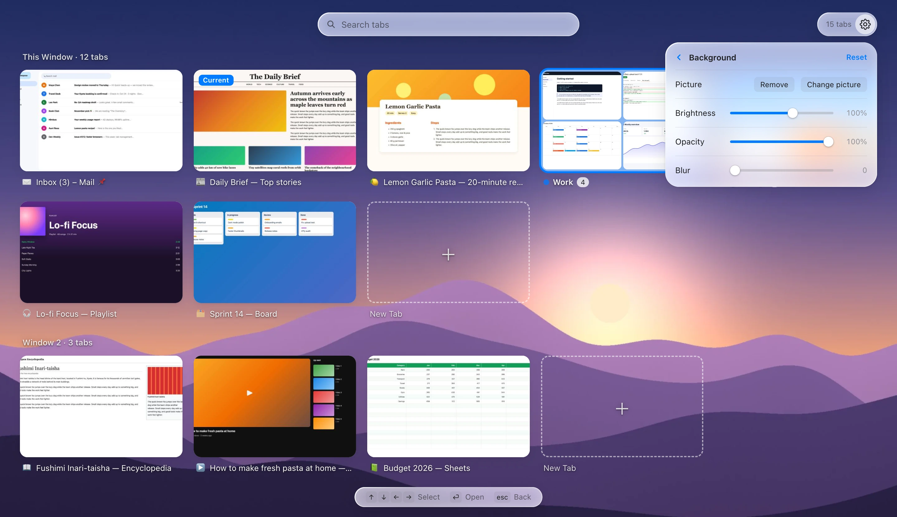

<p align="center"></p>

<h1 align="center">Tab Overview</h1>

<p align="center"><strong>English</strong> · <a href="README.zh-CN.md">简体中文</a></p>

<p align="center">See all your open tabs at once, as a Safari-style thumbnail grid for Chrome.<br>Press <kbd>⌘</kbd><kbd>⇧</kbd><kbd>E</kbd>, spot the tab you want, and jump straight to it.</p>

<picture>
  <source media="(prefers-color-scheme: dark)" srcset="docs/images/en/overview-dark.webp">
  
</picture>

## Features

- **Every tab as a thumbnail**, across all windows, with the current window first.
- **Instant search** by title or URL as you type. Works with IME input such as Pinyin.
- **Keyboard first**: arrow keys to move, <kbd>Enter</kbd> to switch, <kbd>Esc</kbd> to go back.
- **Tab groups** fold into one card showing a mosaic of their tabs; open a group to see all of them.
- **Tidy up in place**: close a tab or a whole group, or open a new tab in any window or group.
- **Light and dark** themes that follow your system; **English and 简体中文** interface.
- **Page thumbnails are opt-in**: off by default, so tabs show their site icon. The first time you turn them on, Tab Overview explains what that means and asks first. Thumbnails stay in the browser's memory, are never saved to disk or sent anywhere, and are cleared when Chrome quits.
- **Your own background**: put a picture behind the overview and adjust its brightness, opacity and blur, with a live preview. The picture stays on your computer.

## Install

Tab Overview isn't on the Chrome Web Store yet, so install it as an unpacked extension:

1. Download **[tab-overview.zip](https://github.com/Jeremy233/tab-overview/releases/latest/download/tab-overview.zip)** from the [latest release](https://github.com/Jeremy233/tab-overview/releases/latest) and unzip it. Put the `tab-overview` folder somewhere it can stay: Chrome loads the extension from that folder every time it starts.
2. Open `chrome://extensions` and turn on **Developer mode** (top right).
3. Click **Load unpacked** and select the `tab-overview` folder (the one with `manifest.json` in it).
4. Optional: click the puzzle-piece icon in Chrome's toolbar and pin **Tab Overview**.
5. Optional: to see a picture of each page instead of its icon, open the overview, click the gear and turn on **Page thumbnails** (see [Page thumbnails](#page-thumbnails)).

It needs Chrome 112 or later. Other Chromium-based browsers should work too, but haven't been tested.

Prefer working from the source? `git clone https://github.com/Jeremy233/tab-overview.git` and load its `extension` folder instead.

### Updating

Click **Check for updates** in the overview's settings. When there's a new version, **Get update** opens its release: download `tab-overview.zip`, unzip it, and replace the files in your `tab-overview` folder with the new ones. Then click the reload button ↻ on the extension's card in `chrome://extensions`. Keep using the same folder: Chrome tells unpacked extensions apart by their folder, so a new folder would be a separate install without your settings or background picture.

## How to use it

### Open and close

Press <kbd>⌘</kbd><kbd>⇧</kbd><kbd>E</kbd> on macOS or <kbd>Ctrl</kbd><kbd>Shift</kbd><kbd>E</kbd> on Windows and Linux, or click the toolbar button. The tab you came from is marked **Current** and already selected. Press the shortcut again, or <kbd>Esc</kbd>, to close the overview and return to it.

> If the shortcut does nothing, another extension may already be using it. Click the shortcut shown in **Settings** to pick your own, or go to `chrome://extensions/shortcuts`.

### Find a tab

Just start typing: the search box already has focus. The search covers the titles and URLs of the tabs in every window. While you search, groups unfold and a colored dot shows which group each tab belongs to; the counter shows matches out of all tabs.


### Keyboard

| Key | Action |
| --- | --- |
| <kbd>⌘</kbd><kbd>⇧</kbd><kbd>E</kbd> / <kbd>Ctrl</kbd><kbd>Shift</kbd><kbd>E</kbd> | Open or close the overview |
| <kbd>↑</kbd> <kbd>↓</kbd> <kbd>←</kbd> <kbd>→</kbd> | Move the selection (while you're typing a search, <kbd>←</kbd> <kbd>→</kbd> move the text cursor) |
| <kbd>Enter</kbd> | Switch to the selected tab, or open the selected group |
| <kbd>Esc</kbd> | Clear the search, then leave the group, then go back to the tab you came from |

With the mouse: click a card to switch to that tab, click **×** to close it, and click **+ New Tab** to open a new tab in that window.

### Tab groups

Each tab group appears as one card with its color, name, number of tabs and a mosaic of up to nine of them. Click it (or press <kbd>Enter</kbd>) to see all of its tabs, and click **‹ All Tabs** (or press <kbd>Esc</kbd>) to go back. **+ New Tab** inside a group adds the new tab to that group. The **×** on a group card closes every tab in the group.


### Settings

Click the gear in the top-right corner to:

- turn page thumbnails on or off;
- see the keyboard shortcut, and click it to change it;
- set a background picture (see below);
- choose the language (follow the browser, 中文 or English);
- see the version and **Check for updates**;
- open the project on **GitHub**.


### Background

In **Settings → Background**, click the small picture (or the switch) and choose an image from your computer. It appears behind the overview straight away, and the text drawn on it turns light or dark to stay readable. The switch hides or shows it again. Click **›** for more:

- **Brightness**, **Opacity** and **Blur** sliders, applied live as you drag them;
- **Change picture** and **Remove**, and **Reset** to go back to the default look.

The picture is scaled to your screen and kept in the extension's own storage on this computer. It's never uploaded.



## Page thumbnails

Thumbnails are **off by default**: every tab is shown with its site icon and name. To see a picture of each page, turn on **Settings → Page thumbnails**. The first time, Tab Overview explains what that involves and asks you to **Accept** or **Decline**. If you decline, thumbnails stay off and you'll be asked again next time. If you accept, Chrome asks you to allow Tab Overview to *“Read and change all your data on all websites”*. That is the access Chrome requires before an extension may capture the visible tab, and Tab Overview uses it for nothing else.

Once you've accepted, the switch turns thumbnails on and off without asking again. Turning it off stops the capturing and deletes every thumbnail immediately; the site access stays granted, so turning thumbnails back on is instant. To take that access back as well, open Tab Overview's details in `chrome://extensions` and change its **Site access**. While thumbnails are off, a small note at the top of the overview points to this setting; click **×** to hide it for good.

While it's on, keep in mind that Chrome only lets extensions capture the tab that is currently on screen. So Tab Overview takes a small screenshot whenever you look at a tab: shortly after you switch to it, after it finishes loading, and right before the overview opens. That means:

- A tab you haven't looked at since turning thumbnails on (or since Chrome started) shows its icon and site name until you visit it once.
- Some pages can't be captured: browser pages such as `chrome://…`, the Chrome Web Store, and local files (unless you turn on **Allow access to file URLs** in the extension's details).
- Thumbnails are kept in memory only, up to about 10 MB (roughly 180 tabs). When that fills up, the thumbnails of tabs you haven't viewed for the longest time are dropped first. Everything is cleared when Chrome quits.

## Permissions

| Permission | Why it's needed |
| --- | --- |
| `tabs` | List your tabs with their titles and URLs; switch to, close and open tabs |
| `tabGroups` | Show tab groups with their names and colors |
| `storage` | Keep thumbnails (in memory only) and your settings |
| `favicon` | Show site icons from Chrome's own cache, without any network requests |
| Access to all sites (optional) | Only asked for when you turn on page thumbnails: Chrome requires it to capture the visible tab |

When you install it, Chrome only mentions reading your browsing history (from `tabs`) and managing tab groups. Tab Overview has no analytics and loads no remote code. The only network request it ever makes is when you click **Check for updates**: it asks GitHub which version this repository's latest release is.

## Regenerating the screenshots

The screenshots in this README are rendered by a script, so they can be refreshed whenever the interface changes. It needs [Node.js](https://nodejs.org) 18 or later and Google Chrome.

```bash
cd tools/screenshots
npm install
npm run screenshots
```

The script starts Chrome in the background with a temporary profile (your own profile isn't touched) and loads a copy of the extension from `extension/` with page thumbnails already turned on. It opens a set of fictional demo sites in two windows, lets the extension capture them, sets the demo background picture, then photographs the overview. Every screenshot uses that picture, so they all look alike; without one, the overview sits on a plain light or dark page. Both languages take about a minute, and the images are written to `docs/images/en/` and `docs/images/zh/`.

- Render one language only: `npm run screenshots -- --lang zh`
- Use a different Chrome or Chromium build: `CHROME_PATH=/path/to/chrome npm run screenshots`
- The demo sites live in `tools/screenshots/demo-sites.js`; the tabs, groups and search term are set at the top of `tools/screenshots/render.js`. The background picture, `tools/screenshots/demo-background.jpg`, is generated art made for this project.

## Publishing a release

Each release is a Git tag with `tab-overview.zip` attached, which is what the install steps and **Check for updates** point to.

1. Raise `version` in `extension/manifest.json` and commit.
2. Tag that commit with the same version and push both: `git tag v0.5.1 && git push origin main v0.5.1`.

The [Release workflow](.github/workflows/release.yml) then checks that the tag matches the manifest, zips `extension/` with `tools/package.sh`, and publishes the release with notes listing the changes since the previous one. To build the zip yourself, run `tools/package.sh`; it's written to `dist/tab-overview.zip`.

## Project layout

```
tab-overview/
├── extension/           the extension itself: this is the folder you load
│   ├── manifest.json
│   ├── background.js    takes thumbnails; handles the toolbar button and shortcut
│   ├── overview.html    the overview page
│   ├── overview.css
│   ├── overview.js
│   ├── i18n.js          interface text in English and 简体中文
│   ├── icons/           extension icon in 16, 32, 48 and 128 px
│   └── _locales/        name and description shown by Chrome
├── docs/images/         icon and screenshots used in this README
├── tools/
│   ├── package.sh       zips extension/ for a release
│   └── screenshots/     script that renders the README screenshots
├── .github/workflows/   publishes a release when a version tag is pushed
├── LICENSE
├── README.md
└── README.zh-CN.md
```

## License

[MIT](LICENSE) © 2026 Jeremy233
