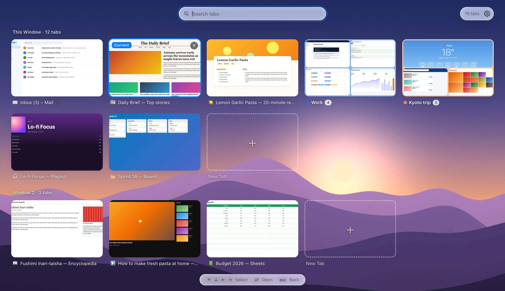
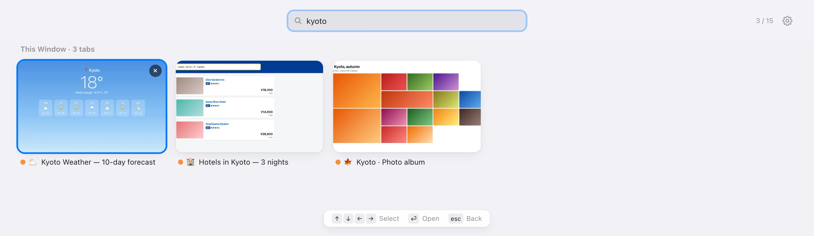
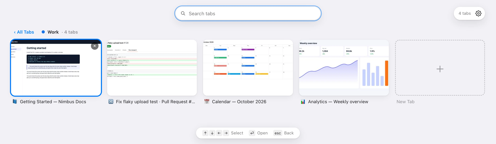
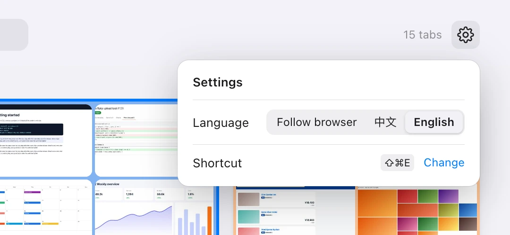

# Tab Overview

**English** · [简体中文](README.zh-CN.md)

See all your open tabs at once, as a Safari-style thumbnail grid for Chrome. Press <kbd>⌘</kbd><kbd>⇧</kbd><kbd>E</kbd>, spot the tab you want, and jump straight to it.

<picture>
  <source media="(prefers-color-scheme: dark)" srcset="docs/images/en/overview-dark.webp">
  
</picture>

## Features

- **Every tab as a thumbnail**, across all windows, with the current window first.
- **Instant search** by title or URL as you type. Works with IME input such as Pinyin.
- **Keyboard first**: arrow keys to move, <kbd>Enter</kbd> to switch, <kbd>Esc</kbd> to go back.
- **Tab groups** fold into one card showing a mosaic of their tabs; open a group to see all of them.
- **Tidy up in place**: close a tab or a whole group, or open a new tab in any window or group.
- **Light and dark** themes that follow your system; **English and 简体中文** interface.
- **Private**: screenshots stay in the browser's memory, are never saved to disk or sent anywhere, and are cleared when Chrome quits.

## Install

Tab Overview isn't on the Chrome Web Store yet, so install it as an unpacked extension:

1. Get the code: `git clone https://github.com/Jeremy233/tab-overview.git`, or click **Code → Download ZIP** on GitHub and unzip it.
2. Open `chrome://extensions` and turn on **Developer mode** (top right).
3. Click **Load unpacked** and select the **`extension`** folder inside the project.
4. Optional: click the puzzle-piece icon in Chrome's toolbar and pin **Tab Overview**.

It needs Chrome 112 or later. Other Chromium-based browsers should work too, but haven't been tested.

To update later, pull the latest code (or download it again) and click the reload button ↻ on the extension's card in `chrome://extensions`.

## How to use it

### Open and close

Press <kbd>⌘</kbd><kbd>⇧</kbd><kbd>E</kbd> on macOS or <kbd>Ctrl</kbd><kbd>Shift</kbd><kbd>E</kbd> on Windows and Linux, or click the toolbar button. The tab you came from is marked **Current** and already selected. Press the shortcut again, or <kbd>Esc</kbd>, to close the overview and return to it.

> If the shortcut does nothing, another extension may already be using it. Pick your own under **Settings → Shortcut → Change**, or at `chrome://extensions/shortcuts`.

### Find a tab

Just start typing: the search box already has focus. The search covers the titles and URLs of the tabs in every window. While you search, groups unfold and a colored dot shows which group each tab belongs to; the counter shows matches out of all tabs.



### Keyboard

| Key | Action |
| --- | --- |
| <kbd>⌘</kbd><kbd>⇧</kbd><kbd>E</kbd> / <kbd>Ctrl</kbd><kbd>Shift</kbd><kbd>E</kbd> | Open or close the overview |
| <kbd>↑</kbd> <kbd>↓</kbd> <kbd>←</kbd> <kbd>→</kbd> | Move the selection (while you're typing a search, <kbd>←</kbd> <kbd>→</kbd> move the text cursor) |
| <kbd>Enter</kbd> | Switch to the selected tab, or open the selected group |
| <kbd>Esc</kbd> | Clear the search, then leave the group, then go back to the tab you came from |

With the mouse: click a card to switch to that tab, click **×** to close it, and click **+ New Tab** to open a new tab in that window.

### Tab groups

Each tab group appears as one card with its color, name, number of tabs and a mosaic of up to nine of them. Click it (or press <kbd>Enter</kbd>) to see all of its tabs, and click **‹ All Tabs** (or press <kbd>Esc</kbd>) to go back. **+ New Tab** inside a group adds the new tab to that group. The **×** on a group card closes every tab in the group.



### Settings

Click the gear in the top-right corner to choose the language (follow the browser, 中文 or English) and to see or change the keyboard shortcut.



## How the thumbnails work

Chrome only lets extensions take a screenshot of the tab that is currently on screen. So Tab Overview takes a small screenshot whenever you look at a tab: shortly after you switch to it, after it finishes loading, and right before the overview opens. That means:

- A tab you haven't looked at since Chrome started shows its icon and site name until you visit it once.
- Some pages can't be captured: browser pages such as `chrome://…`, the Chrome Web Store, and local files (unless you turn on **Allow access to file URLs** in the extension's details).
- Thumbnails are kept in memory only, up to about 10 MB (roughly 180 tabs). When that fills up, the thumbnails of tabs you haven't viewed for the longest time are dropped first. Everything is cleared when Chrome quits.

## Permissions

| Permission | Why it's needed |
| --- | --- |
| `tabs` | List your tabs with their titles and URLs; switch to, close and open tabs |
| `tabGroups` | Show tab groups with their names and colors |
| `storage` | Keep thumbnails (in memory only) and your language setting |
| `favicon` | Show site icons from Chrome's own cache, without any network requests |
| Access to all sites | Chrome requires it to screenshot the visible tab |

Tab Overview makes no network requests, has no analytics and loads no remote code.

## Regenerating the screenshots

The screenshots in this README are rendered by a script, so they can be refreshed whenever the interface changes. It needs [Node.js](https://nodejs.org) 18 or later and Google Chrome.

```bash
cd tools/screenshots
npm install
npm run screenshots
```

The script starts Chrome in the background with a temporary profile (your own profile isn't touched) and loads the extension from `extension/`. It opens a set of fictional demo sites in two windows, lets the extension capture them, then photographs the overview. Both languages take about a minute, and the images are written to `docs/images/en/` and `docs/images/zh/`.

- Render one language only: `npm run screenshots -- --lang zh`
- Use a different Chrome or Chromium build: `CHROME_PATH=/path/to/chrome npm run screenshots`
- The demo sites live in `tools/screenshots/demo-sites.js`; the tabs, groups and search term are set at the top of `tools/screenshots/render.js`.

## Project layout

```
tab-overview/
├── extension/           the extension itself: this is the folder you load
│   ├── manifest.json
│   ├── background.js    takes thumbnails; handles the toolbar button and shortcut
│   ├── overview.html    the overview page
│   ├── overview.css
│   ├── overview.js
│   ├── i18n.js          interface text in English and 简体中文
│   └── _locales/        name and description shown by Chrome
├── docs/images/         screenshots used in this README
├── tools/screenshots/   script that renders those screenshots
├── LICENSE
├── README.md
└── README.zh-CN.md
```

## License

[MIT](LICENSE) © 2026 Jeremy233
