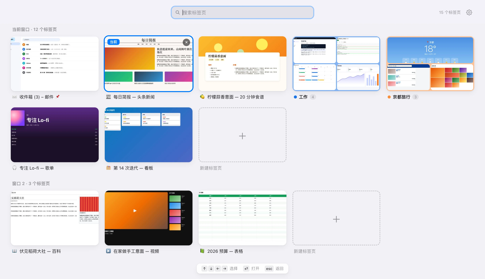
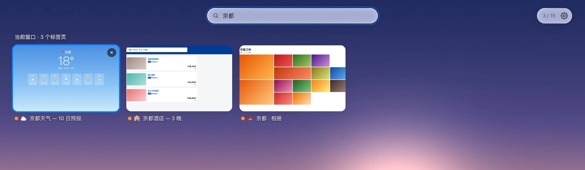
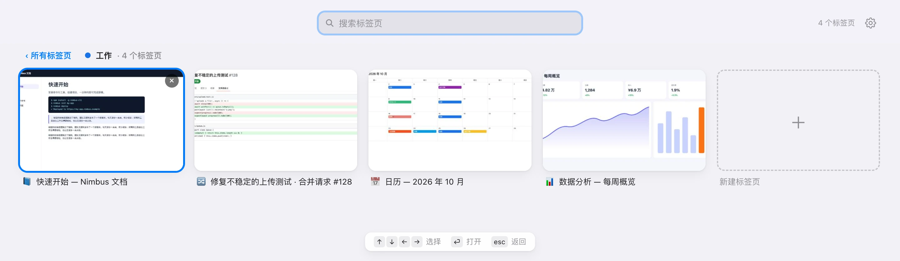
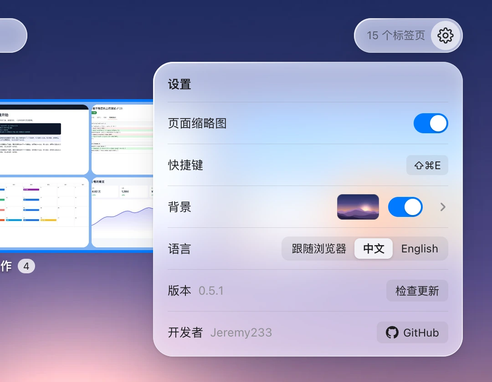
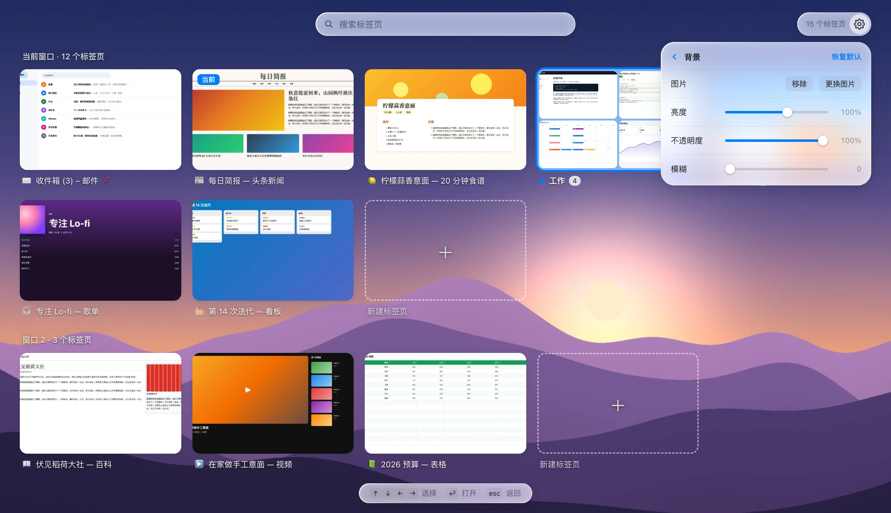

<p align="center"></p>

<h1 align="center">Tab Overview</h1>

<p align="center"><a href="README.md">English</a> · <strong>简体中文</strong></p>

<p align="center">像 Safari 一样，用缩略图网格一眼看清 Chrome 里打开的所有标签页。<br>按下 <kbd>⌘</kbd><kbd>⇧</kbd><kbd>E</kbd>，找到想要的标签页，直接跳过去。</p>

<picture>
  <source media="(prefers-color-scheme: dark)" srcset="docs/images/zh/overview-dark.webp">
  
</picture>

## 功能

- **所有标签页一览无余**：跨所有窗口显示缩略图，当前窗口排在最前。
- **即时搜索**：按标题或网址边输入边过滤，支持拼音等输入法。
- **键盘优先**：方向键移动，<kbd>Enter</kbd> 切换，<kbd>Esc</kbd> 返回。
- **标签页分组**：每个分组折叠成一张卡片，显示组内标签页的拼图；点开即可查看全部。
- **就地整理**：关闭单个标签页或整个分组（Chrome 会保留这个分组），或在任意窗口、分组里新建标签页。
- **浅色 / 深色**主题跟随系统；界面支持**简体中文和英文**。
- **页面缩略图需手动开启**：默认关闭，标签页只显示网站图标。第一次打开时，会先说明清楚并征得你的同意。缩略图只保存在浏览器内存里，不写入硬盘、不上传，关闭 Chrome 后自动清除。
- **自定义背景**：选一张自己的图片放在总览后面，可以调节亮度、不透明度和模糊，实时预览。图片只保存在你的电脑上。

## 安装

目前还没有上架 Chrome 网上应用店，需要以"已解压的扩展程序"方式安装：

1. 从[最新版本](https://github.com/Jeremy233/tab-overview/releases/latest)下载 **[tab-overview.zip](https://github.com/Jeremy233/tab-overview/releases/latest/download/tab-overview.zip)** 并解压。把得到的 `tab-overview` 文件夹放在一个不会删掉的地方：Chrome 每次启动都从这个文件夹加载扩展。
2. 打开 `chrome://extensions`，打开右上角的 **开发者模式**。
3. 点 **加载已解压的扩展程序**，选择 `tab-overview` 文件夹（里面有 `manifest.json` 的那个）。
4. 可选：点 Chrome 工具栏上的拼图图标，把 **Tab Overview** 固定到工具栏。
5. 可选：想看到网页缩略图而不只是图标，就打开总览，点齿轮，打开 **页面缩略图**（见下文[页面缩略图](#页面缩略图)）。

需要 Chrome 112 或更高版本。其他基于 Chromium 的浏览器理论上也能用，但还没有测试过。

想直接用源码的话，也可以 `git clone https://github.com/Jeremy233/tab-overview.git`，然后加载其中的 `extension` 文件夹。

### 更新

在总览页的设置里点 **检查更新**。有新版本时点 **去下载**，会打开新版本的发布页：下载 `tab-overview.zip`，解压后用新文件替换掉原来 `tab-overview` 文件夹里的文件，再到 `chrome://extensions` 里点这个扩展卡片上的刷新按钮 ↻。请一直用同一个文件夹：Chrome 是按文件夹区分已解压的扩展的，换一个文件夹就成了另一个扩展，原来的设置和背景图都不会带过去。

## 使用方法

### 打开与关闭

在 macOS 上按 <kbd>⌘</kbd><kbd>⇧</kbd><kbd>E</kbd>，在 Windows 和 Linux 上按 <kbd>Ctrl</kbd><kbd>Shift</kbd><kbd>E</kbd>，或者点工具栏按钮。你原来所在的标签页会标上 **当前**，并且已经选中。再按一次快捷键或按 <kbd>Esc</kbd>，就会关闭总览，回到原来的标签页。

> 如果按快捷键没反应，可能是被其他扩展占用了。在 **设置** 里点一下显示的快捷键就能换一个，或者直接打开 `chrome://extensions/shortcuts` 设置。

### 查找标签页

直接打字就行，搜索框默认已经获得焦点。会在所有窗口中按标题和网址查找。搜索时分组会自动展开，每个标签页前的彩色圆点表示它属于哪个分组；右上角显示"匹配数 / 总数"。



### 键盘操作

| 按键 | 作用 |
| --- | --- |
| <kbd>⌘</kbd><kbd>⇧</kbd><kbd>E</kbd> / <kbd>Ctrl</kbd><kbd>Shift</kbd><kbd>E</kbd> | 打开或关闭总览 |
| <kbd>↑</kbd> <kbd>↓</kbd> <kbd>←</kbd> <kbd>→</kbd> | 移动选中的卡片（输入搜索词时，<kbd>←</kbd> <kbd>→</kbd> 用来移动光标） |
| <kbd>Enter</kbd> | 切换到选中的标签页，或打开选中的分组 |
| <kbd>Esc</kbd> | 依次：清空搜索 → 退出分组 → 回到原来的标签页 |

鼠标操作：点卡片切换到该标签页，点 **×** 关闭，点 **+ 新建标签页** 在该窗口新开一个标签页。

### 标签页分组

每个分组显示为一张卡片，带有分组的颜色、名称、标签页数量，以及最多九个标签页拼成的缩略图。点击它（或按 <kbd>Enter</kbd>）查看组内所有标签页，点 **‹ 所有标签页**（或按 <kbd>Esc</kbd>）返回。在分组里点 **+ 新建标签页**，新标签页会直接加入这个分组。分组卡片上的 **×** 会关闭这个分组，但不会删除它：组内标签页都会关闭，分组仍留在 Chrome 已保存的标签页分组里，也就是书签栏最左边，点一下就能连同所有标签页重新打开。Chrome 没有给扩展提供直接这样做的接口，所以 Tab Overview 会先把分组移到一个最小化的新窗口，再关掉这个窗口；Chrome 在窗口关闭时会保留其中的分组。在分组里逐个关闭标签页则不一样：关掉最后一个时，Chrome 会删除这个已保存的分组。



### 设置

点右上角的齿轮图标，可以：

- 开关页面缩略图；
- 查看快捷键，点一下就能修改；
- 设置背景图片（见下文）；
- 切换界面语言（跟随浏览器、中文或 English）；
- 查看版本号，并 **检查更新**；
- 打开项目的 **GitHub** 页面。



### 背景

在 **设置 → 背景** 里点那张小图（或者直接点开关），从电脑里选一张图片。它会立刻出现在总览后面，图片上的文字会自动变成浅色或深色，保证看得清。开关可以随时隐藏或显示背景。点 **›** 进入二级菜单：

- **亮度**、**不透明度**、**模糊** 三个滑块，拖动时实时生效；
- **更换图片**、**移除**，以及 **恢复默认**。

图片会按屏幕大小缩放后，保存在扩展自己的本地存储里，只在这台电脑上，不会上传。



## 页面缩略图

缩略图**默认关闭**：每个标签页只显示网站图标和域名。想看到网页缩略图，就打开 **设置 → 页面缩略图**。第一次打开时，Tab Overview 会先说明会做什么，让你选择 **接受** 或 **拒绝**。拒绝的话开关保持关闭，下次打开时还会再问。接受之后，Chrome 会询问是否允许 Tab Overview *"读取和更改您在所有网站上的所有数据"*：这是 Chrome 允许扩展截取当前标签页的前提，Tab Overview 只用它来拍缩略图，不做别的。

接受过一次之后，再开关缩略图都不会再弹提示。关掉开关会立即停止截图并删除所有缩略图；网站访问权限仍然保留，所以再次打开时马上生效。如果想连这项权限也收回，在 `chrome://extensions` 里打开 Tab Overview 的详情，修改 **网站访问权限** 即可。缩略图关闭时，总览页顶部会有一行小提示指向这个设置；点 **×** 后就不再显示。

开启之后要注意，Chrome 只允许扩展截取当前显示在屏幕上的那个标签页。所以 Tab Overview 会在你看某个标签页的时候顺手截一张小图：切换过去后不久、页面加载完成后，以及打开总览之前。因此：

- 开启缩略图后（或 Chrome 启动后）还没看过的标签页，会先显示网站图标和域名，看过一次后就有缩略图了。
- 有些页面无法截图：`chrome://…` 等浏览器内置页面、Chrome 网上应用店，以及本地文件（除非在扩展详情里打开 **允许访问文件网址**）。
- 缩略图只保存在内存里，上限约 10 MB（大约 180 个标签页）。存满后，最久没看过的标签页的缩略图会先被删掉。关闭 Chrome 后全部清除。

## 权限说明

| 权限 | 用途 |
| --- | --- |
| `tabs` | 列出标签页及其标题和网址；切换、关闭、新建标签页 |
| `tabGroups` | 显示标签页分组的名称和颜色 |
| `storage` | 保存缩略图（仅在内存中）和各项设置 |
| `favicon` | 从 Chrome 自身的缓存读取网站图标，不发起任何网络请求 |
| 访问所有网站的数据（可选） | 只在你打开页面缩略图时才会申请：Chrome 要求有这个权限才能截取当前标签页 |

安装时 Chrome 只会提示"读取您的浏览记录"（来自 `tabs`）和管理标签页分组。Tab Overview 没有统计分析，也不加载远程代码。它唯一会发起的网络请求，是在你点 **检查更新** 时，向 GitHub 查询本仓库最新发布的版本号。

## 重新生成截图

README 里的截图是用脚本自动生成的，界面改动后可以随时重新生成。需要 [Node.js](https://nodejs.org) 18 或更高版本，以及 Google Chrome。

```bash
cd tools/screenshots
npm install
npm run screenshots
```

脚本会在后台用一个临时配置启动 Chrome（不会动你自己的浏览器数据），从 `extension/` 加载一份已开启页面缩略图的扩展副本，在两个窗口里打开一组虚构的演示网站，等扩展截好缩略图、设好演示背景图后，再给总览页拍照。所有截图都用这张背景图，风格保持一致；不设背景图时，总览页是纯浅色或纯深色的底。中英文两套大约需要一分钟，图片会写入 `docs/images/en/` 和 `docs/images/zh/`。

- 只生成一种语言：`npm run screenshots -- --lang zh`
- 使用其他 Chrome 或 Chromium：`CHROME_PATH=/path/to/chrome npm run screenshots`
- 演示网站在 `tools/screenshots/demo-sites.js` 里；要打开哪些标签页、怎么分组、搜什么词，在 `tools/screenshots/render.js` 开头设置。背景图 `tools/screenshots/demo-background.jpg` 是为本项目生成的图片。

## 发布新版本

每个版本就是一个 Git 标签，附带 `tab-overview.zip`，安装步骤和 **检查更新** 都指向它。

1. 改大 `extension/manifest.json` 里的 `version`，然后提交。
2. 给这个提交打上同样版本号的标签，并一起推送：`git tag v0.5.1 && git push origin main v0.5.1`。

[Release 工作流](.github/workflows/release.yml)会检查标签和 manifest 里的版本号是否一致，用 `tools/package.sh` 把 `extension/` 打成压缩包，然后发布这个版本，并自动列出自上个版本以来的改动。想自己打包的话，运行 `tools/package.sh`，压缩包会生成在 `dist/tab-overview.zip`。

## 项目结构

```
tab-overview/
├── extension/           扩展本体：安装时加载的就是这个文件夹
│   ├── manifest.json
│   ├── background.js    截取缩略图；处理工具栏按钮和快捷键
│   ├── overview.html    总览页面
│   ├── overview.css
│   ├── overview.js
│   ├── i18n.js          中英文界面文字
│   ├── icons/           16、32、48、128 像素的扩展图标
│   └── _locales/        Chrome 显示的扩展名称和描述
├── docs/images/         README 里用到的图标和截图
├── tools/
│   ├── package.sh       把 extension/ 打成发布用的压缩包
│   └── screenshots/     生成 README 截图的脚本
├── .github/workflows/   推送版本标签时自动发布新版本
├── LICENSE
├── README.md
└── README.zh-CN.md
```

## 开源许可

[MIT](LICENSE) © 2026 Jeremy233
